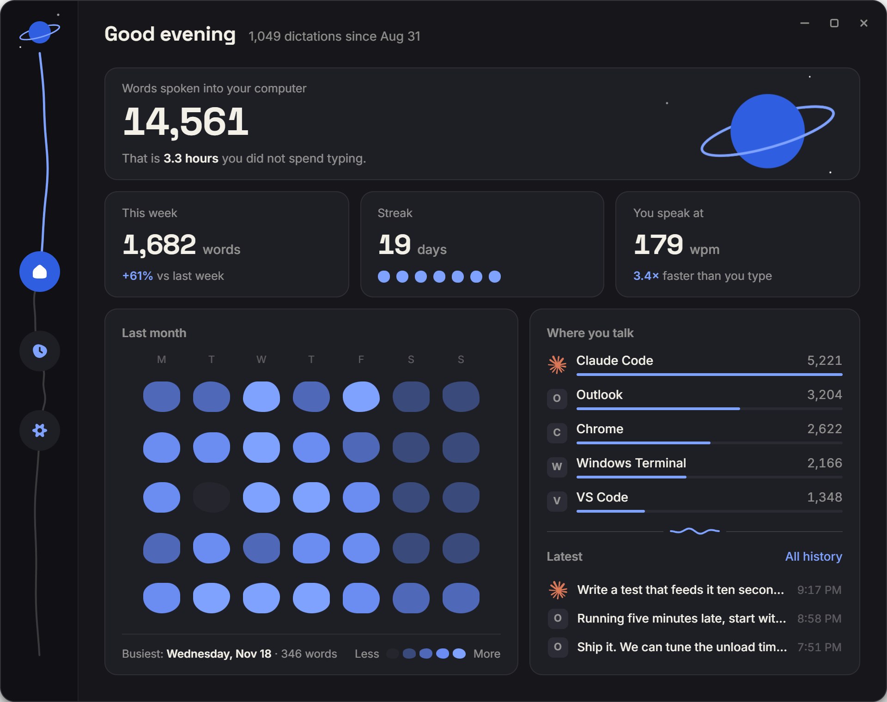

<div align="center">


# Neptune

<a href="../../releases/latest"></a>
<a href="LICENSE"></a>
<a href="https://neptunetype.com"></a>

**Free voice dictation for Windows that runs entirely on your PC.**
Hold `Ctrl` + `Space`, talk, let go, and clean text lands wherever your cursor is.

<!-- STORE_ID: replace with the Store ID from Partner Center once the name is reserved, e.g. https://apps.microsoft.com/detail/9NXXXXXXXXXX -->
<a href="https://apps.microsoft.com/detail/STORE_ID"></a>
&nbsp;
<a href="../../releases"></a>



</div>

## What it does

- **Hold to talk** in any app with a text cursor: Outlook, Slack, Chrome, VS Code, Claude Code, Windows Terminal, anything. Let go and the words are pasted at the cursor. If there's nowhere to type, the pill offers a Copy button.
- **Cleans up as it goes**: ums and uhs come out, and "new line" or "new paragraph" do what they say.
- **Hands-free** for longer dictation, **paste last** to put your last dictation in again, and a searchable **history** of everything you've said.
- **Home** shows what you've saved: words spoken, hours not spent typing, your streak, how fast you speak, and where you talk.
- A small **pill** at the bottom of the screen shows only while you talk.

A free, open-source alternative to Wispr Flow: no account, no cloud, no subscription, no word limit.

## Shortcuts

| Action | Keys |
| --- | --- |
| Hold to talk | hold `Ctrl` + `Space`, let go to paste |
| Hands-free | `Ctrl` + `Shift` + `Space` to start, again to finish |
| Cancel | `Esc` while listening |
| Paste last | `Ctrl` + `Shift` + `V` |
| Open history | `Ctrl` + `Shift` + `H` |

All of them can be changed in Settings.

## Privacy

Your voice is turned into text on your own PC. Audio, text and history never leave it. The speech model downloads once during setup; after that Neptune never goes online, not even to check for updates, unless you click **Check for updates** in Settings. No account, no analytics, no ads. The Microsoft Store version is kept up to date by the Store. Full [Privacy Policy](https://neptunetype.com/privacy/).

How far your voice travels, for scale: Neptune is about 2.8 billion miles away. A Wispr Flow dictation from San Francisco travels about 4,818 miles, to Virginia and back, so about 580,000 of them would carry your voice to Neptune. At 100 a day, that's 16 years. With Neptune, each one travels 1.5 feet: you'd need about 9.8 trillion, or 270 million years.

## How it works

```
hotkey -> mic (16 kHz) -> silence trimmed -> speech model -> cleanup -> paste at cursor
```

- **Speech model**: NVIDIA Parakeet TDT 0.6B v3 (25 European languages), int8 ONNX on the CPU. A GPU made no measurable difference, so there is no GPU option. It loads when you talk and unloads after a minute idle, so Neptune costs about 70 MB when you're not using it.
- **Chunking**: while you talk, the audio is cut at pauses and transcribed as you go, so letting go feels instant however long you spoke.
- **Cleanup**: rules only, no LLM: filler words, spoken layout commands, repeated words.
- **Insert**: a clipboard paste, with your old clipboard put back afterwards.
- **Hold-to-talk**: a low-level keyboard hook catches the trigger key so it never types. Modifiers are never faked, so Windows always sees your real keys.

## Stack

Tauri 2. Rust does everything that touches the OS. The window is plain HTML, CSS and JS in a frameless webview, built only while it's open.

## Is it free? What's the catch?

No catch. It's a hobby project I built because I needed it, and it's open source. No account, no ads, no tracking, no money. If you're like so into dictation that you need to give something to someone, please give it to the [Alzheimer's Association](https://www.alz.org/).

## License

MIT. See [LICENSE](LICENSE). The speech model keeps its own licence (Parakeet: CC-BY-4.0). Made by [Aron Frishberg](https://aronfrishberg.com/).
